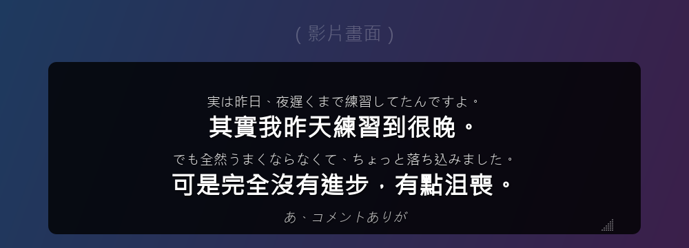
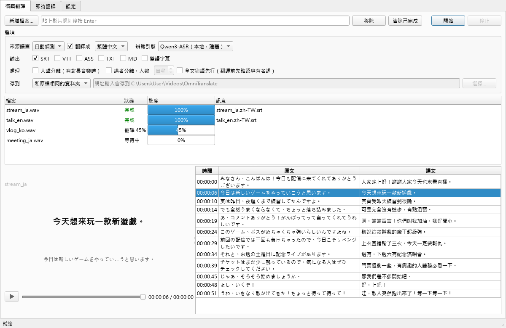
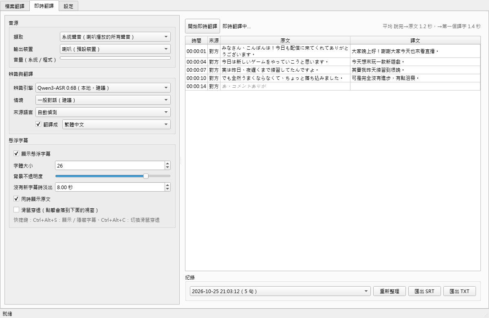
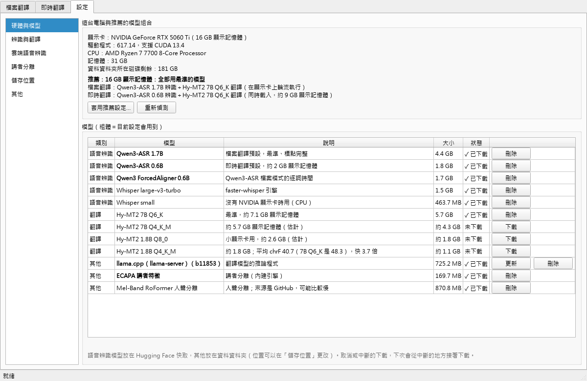

# Mimiyaku（耳訳）

[](LICENSE)


在自己的電腦上把影片、直播、會議的語音轉成字幕並翻譯成繁體中文。辨識和翻譯都可以完全在本機執行，不用把聲音上傳到任何地方。

本專案專為即時翻譯和音檔翻譯而進行設計的，可採用本地stt模型加上本地語言模型進行翻譯，也可選擇使用阿里雲FUN-ASR進行雲端stt再加上本地語言模型進行翻譯。推薦顯存小於8GB的使用者使用雲端stt加上本地語言模型翻譯，使用介面內也有診斷可以推薦你要使用哪一種組合。

推薦搭配VB-audio使用

> **English:** Mimiyaku (耳訳, "translating by ear") is a Windows desktop app that transcribes and translates speech into subtitles, both from files and live from any app's audio. Speech recognition (Qwen3-ASR / faster-whisper, or optional cloud engines) and translation (Hy-MT2 via llama.cpp) run locally on your GPU. The UI is in Traditional Chinese; Japanese, English and Korean → Traditional Chinese are the tuned language pairs.



## 功能

**檔案翻譯**：影片、音檔或影片網址（YouTube 等）→ 字幕檔
- 輸出 SRT、VTT、ASS（可雙語）、TXT、Markdown。
- **純紀錄模式**：只辨識不翻譯，加上講者分離，輸出逐字稿。
- **人聲分離**：有背景音樂時，先把人聲抽出來再辨識。
- **全文術語先行**：翻譯前先讀完全文，整理出摘要和人名、專有名詞，讓你確認譯法，整部片的翻譯就會一致。
- **斷點續作**：中途停止或當機，下次從斷掉的地方繼續。
- 播放器同步顯示原文和譯文，點字幕清單可以跳到那個時間點。

**即時翻譯**：一邊播放一邊出字幕
- 音源可以選系統聲音、**只收某個程式的聲音**（例如瀏覽器，不會收到 Discord 或通知音）、麥克風，或麥克風＋系統聲音（線上會議）。
- 兩段式字幕：原文邊聽邊出現，句子結束後譯文逐字長出來。說完到看到譯文大約 1.3～1.7 秒。
- 懸浮字幕：永遠在最上層、半透明、可拖曳、可調大小，會依視窗大小決定顯示幾句；可以設定滑鼠穿透。
- 每次都會留下紀錄，之後可以匯出 SRT 或 TXT。

**其他**
- 第一次開啟時偵測顯示卡，推薦一組放得下的模型並自動下載。
- 可選的雲端辨識：阿里雲 Fun-ASR、OpenAI、Google Cloud Speech。金鑰存在 Windows 認證管理員，不會寫進設定檔。
- 內建直播用語術語表；也可以加入自己的術語。

| 檔案翻譯 | 即時翻譯 |
|---|---|
|  |  |



## 系統需求

- Windows 10 或 11（64 位元）
- **NVIDIA 顯示卡，建議 8 GB 以上顯示記憶體**，驅動程式要支援 CUDA 13（2025 年後的驅動）
  - 顯示記憶體較少時會推薦較小的模型。沒有 NVIDIA 顯示卡也能跑，但用 CPU 很慢，建議搭配雲端辨識。
- 記憶體 16 GB 以上
- 硬碟空間：模型約 10～20 GB，依選擇的組合而定

## 安裝

### 一鍵安裝（建議）

1. 到 [Releases](https://github.com/Oscar0711/mimiyaku/releases/latest) 下載 `install.bat`。
2. 點兩下執行。
   - Windows 可能會跳出「Windows 已保護您的電腦」，按「其他資訊」→「仍要執行」。
   - 這個檔案是純文字，可以先用記事本打開檢查內容。
3. 照畫面指示選擇安裝位置（直接按 Enter 用預設位置）。

它會自動完成這些事：
- 安裝 uv、Git、ffmpeg（已經有的會跳過；第一次使用 winget 時可能要你按 Y 同意）
- 下載程式、安裝套件（第一次要下載 PyTorch 等數 GB 的套件，需要一點時間）
- 在桌面和開始功能表建立捷徑，然後開啟程式

第一次開啟時，程式會偵測顯示卡，列出推薦的模型組合，勾選後就會開始下載。

**更新到最新版**：再執行一次 `install.bat` 就好，只會下載有改動的部分。

### 手動安裝

1. 安裝 [uv](https://docs.astral.sh/uv/getting-started/installation/)（Python 套件管理工具）、Git 和 ffmpeg：

   ```bash
   winget install --id astral-sh.uv
   winget install --id Git.Git
   winget install --id Gyan.FFmpeg
   ```

   裝完後關掉終端機再重開。

2. 下載程式並安裝套件：

   ```bash
   git clone https://github.com/Oscar0711/mimiyaku.git
   cd mimiyaku
   uv sync
   ```

3. 開啟程式：

   ```bash
   uv run mimiyaku-gui
   ```

4. 不想每次都開終端機的話，可以到「設定 → 其他」建立桌面捷徑。

更新到最新版：在 `mimiyaku` 資料夾執行 `git pull`，再執行 `uv sync`。

## 使用方式

**檔案翻譯**分頁
- 把影音檔拖進視窗，或貼上影片網址，勾選選項後按「開始」。
- 佇列會顯示每個檔案目前在哪個階段；雙擊已完成的檔案會開啟輸出資料夾。
- 按「停止」後，已完成的部分會保留，下次按「開始」會從斷點繼續。

**即時翻譯**分頁
- 選音源和辨識引擎，按「開始即時翻譯」。
- 快捷鍵：`Ctrl+Alt+S` 顯示／隱藏字幕，`Ctrl+Alt+C` 切換滑鼠穿透。

**設定**分頁
- **硬體與模型**：顯示偵測到的顯示卡和推薦組合；每個模型都可以下載、刪除，中斷的下載下次會接著下載。
- **辨識與翻譯**：檔案翻譯和即時翻譯可以用不同的模型；字幕每行字數、行數、閱讀速度。
- **雲端語音辨識**：填入金鑰，按「測試」確認是否有效。**雲端服務會依使用量計費**，請留意各家的價格。
- **講者分離**：內建引擎不需要帳號。也可以改用 pyannote（較準）：先到 [pyannote/speaker-diarization-community-1](https://hf.co/pyannote/speaker-diarization-community-1) 同意使用條款，再執行 `uv run hf auth login` 登入。
- **儲存位置**：工作檔和模型可以搬到其他磁碟。
- **其他**：建立捷徑、回報問題、還原預設設定。

## 命令列

不開介面也可以處理檔案，適合批次作業：

```bash
uv run mimiyaku file 影片.mp4 --to zh-TW
uv run mimiyaku file 會議.m4a --no-translate --diarize --formats md,txt  # 純紀錄＋講者分離
uv run mimiyaku file 直播.mp4 --terms --bilingual                         # 全文術語先行、雙語字幕
uv run mimiyaku file https://www.youtube.com/watch?v=...                  # 影片網址
uv run mimiyaku models recommend --apply                                  # 依硬體套用推薦設定
uv run mimiyaku models download hy-mt2-7b-q6 llama-server
uv run mimiyaku doctor                                                    # 檢查環境
```

設定檔在 `%LOCALAPPDATA%\Mimiyaku\config.yaml`。

## 用到的模型

模型不包含在這個專案裡，是使用時從各自的官方來源下載的。授權以各模型頁面為準。

| 用途 | 模型 | 授權 |
|---|---|---|
| 語音辨識 | [Qwen3-ASR](https://huggingface.co/Qwen/Qwen3-ASR-1.7B)、[Qwen3-ForcedAligner](https://huggingface.co/Qwen/Qwen3-ForcedAligner-0.6B) | Apache-2.0 |
| 語音辨識 | [faster-whisper large-v3-turbo](https://huggingface.co/mobiuslabsgmbh/faster-whisper-large-v3-turbo) | MIT |
| 翻譯 | [Hy-MT2](https://huggingface.co/tencent/Hy-MT2-7B-GGUF)（騰訊） | 見模型頁面 |
| 翻譯推論 | [llama.cpp](https://github.com/ggml-org/llama.cpp) | MIT |
| 講者分離 | [ECAPA-TDNN](https://huggingface.co/speechbrain/spkrec-ecapa-voxceleb)（SpeechBrain） | Apache-2.0 |
| 講者分離（可選） | [pyannote community-1](https://huggingface.co/pyannote/speaker-diarization-community-1) | CC-BY-4.0 |
| 人聲分離 | Mel-Band RoFormer（透過 [audio-separator](https://github.com/nomadkaraoke/python-audio-separator)） | 見 audio-separator |

各模型的比較和實測數據寫在 [docs/design.md](docs/design.md)。

## 意見回報

- **遇到問題**：程式裡的「設定 → 其他 → 回報問題」會開啟回報表單，並自動帶入版本和顯示卡資訊。也可以直接到 [Issues](https://github.com/Oscar0711/mimiyaku/issues/new/choose) 回報。
- **功能建議**：同樣在 Issues 選「功能建議」。
- **使用問題、想法、心得**：到 [討論區](https://github.com/Oscar0711/mimiyaku/discussions)。

回報時請不要貼上 API 金鑰。安全性問題請看 [SECURITY.md](SECURITY.md)。

## 參與開發

歡迎送 Pull Request！開發環境、測試方式和注意事項請看 [CONTRIBUTING.md](CONTRIBUTING.md)。

## 授權

本專案以 [GNU Affero General Public License v3.0](LICENSE)（AGPL-3.0）授權：

- 可以自由使用、修改、分享，也可以商業使用。
- 發布修改過的版本，或用修改過的版本提供網路服務時，必須以相同授權公開完整原始碼。
- 本軟體不提供任何保證。
